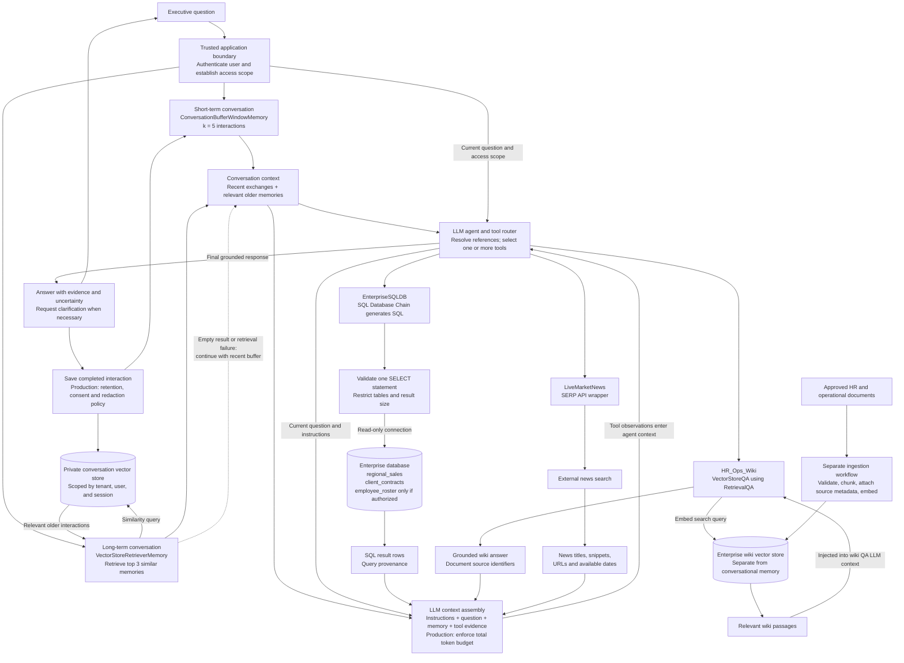

# Enterprise RAG Agent Pipeline

The agent combines recent conversation, relevant older memories, and
authoritative tool results. A question may require multiple tools.

## Schema mapping

- `regional_sales`: region, Q1 revenue, Q2 revenue, and target margin.
- `client_contracts`: client names, contract values in USD, and contract status.
- `employee_roster`: department, role, and clearance level; restricted by default.

The schema defines no foreign keys between these tables. Do not invent joins.

The sales table has no reporting year or explicit currency. Questions requiring
those attributes need clarification or additional authoritative metadata.

## Read-only SQL boundary

The SQL chain generates SQL without executing it. A separate wrapper validates
the statement and executes it against a read-only database connection.

For the local stub, SQLite uses URI `mode=ro` and `PRAGMA query_only=ON`.
Production PostgreSQL should use a dedicated role with SELECT privileges only
on approved views, with row access policies where required.

Prompt instructions and SQL parsing supplement database permissions; they do
not replace them.

## Memory behavior

Recent conversation is always available. Semantic retrieval adds older relevant
interactions. Empty results or semantic-store failures leave the recent buffer
available as a fallback.

Memory is conversation context, not authoritative evidence for current revenue,
policies, or news. Those facts must be retrieved again when needed.

## Implementation boundary

The configuration stub demonstrates memory, routing, retrieval, and read-only
SQL execution. Production authentication, document ingestion, strict token
budget enforcement, distributed storage, and retention enforcement remain
separate implementation work.